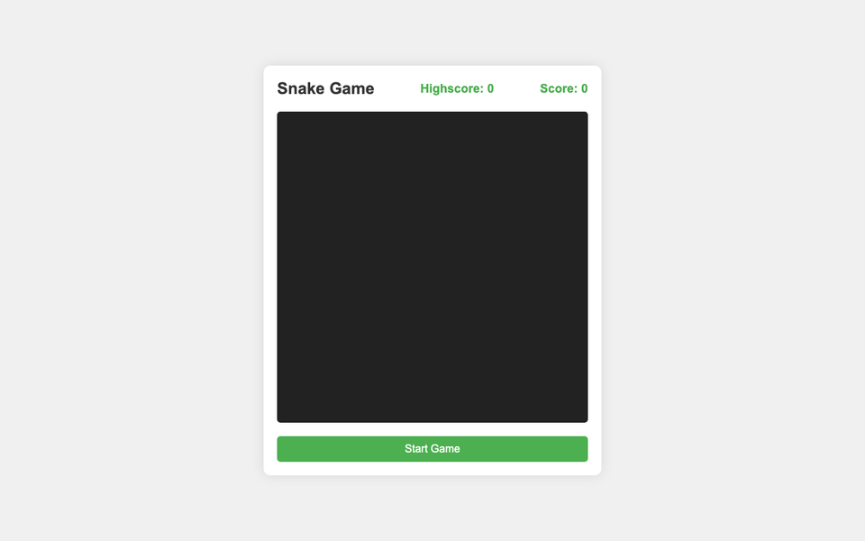

# Snake Game 🐍

The classic Snake on an HTML5 canvas: eat the food, grow, and avoid the walls and your own tail.

**Live demo:** https://mccprogrammer.github.io/simple-snake-game/



## Features

- Arrow keys or WASD, plus on-screen buttons on phones
- Score and high score, the high score saved in `localStorage`
- Responsive canvas

## Run it locally

No build step: clone the repo and open `index.html` in a browser.

```bash
git clone https://github.com/MCCProgrammer/simple-snake-game.git
open simple-snake-game/index.html
```

## Built with

HTML5 Canvas, CSS and plain JavaScript.

---

One of my first web projects. More of my work at [mccprogrammer.com/projects](https://mccprogrammer.com/projects).
